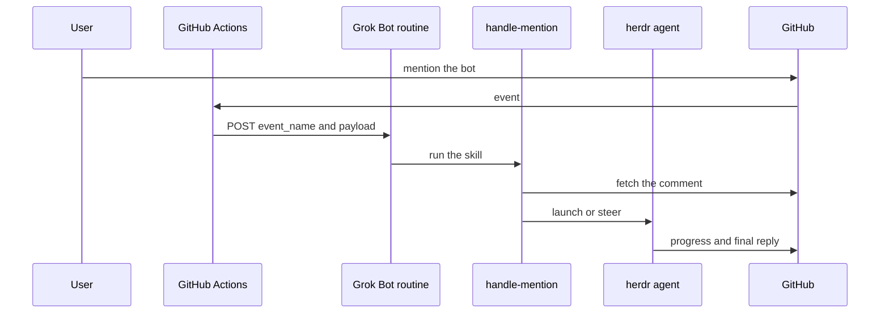

# mentions

[](https://github.com/gdsrvnt/mentions/actions/workflows/ci.yml)

`mentions` forwards a GitHub @mention of your bot to a Grok Bot routine, then an agent replies on that same thread. You choose the person whose mentions count and the handle they write. The plugin installs into any repository you can push.

## How it works



A workflow in the target repository posts `{event_name, payload}` to the Grok Bot webhook routine. The routine runs `skills/handle-mention/SKILL.md`. That skill calls `scripts/route-event.mjs`, fetches the comment from GitHub, and starts one herdr agent for the thread. The agent writes the progress comments and the final reply. The dispatcher does not post those for it.

`scripts/route-event.mjs` reads `{event_name, payload, config, seen}` and prints `{accept, reason, thread_key, agent_name, text_source, reply_target, ledger}`. `text_source` is the GitHub object to fetch. `reason` is `ok`, `wrong_repo`, `wrong_sender`, `no_mention`, `fork_review`, `duplicate`, `unsupported_event`, or another drop listed in the script. Logins and handles match without case. `@bot` does not match `@bot2`.

`skills/setup-mentions/SKILL.md` is the installer entry point. It runs `scripts/install.sh`.

## Requirements

| Tool | Version | Why |
| --- | --- | --- |
| Grok Bot | 0.49.0 | Webhook routines and secret cards. The marketplace listing is hidden from Cursor IDE. |
| herdr | 0.9.3 | Launches the reply agent. Install from `https://herdr.dev` and put `herdr` on `PATH`. |
| git | any current | Clones the target repository during install. |
| gh | any current | Opens the workflow pull request and calls the GitHub API. |
| jq | any current | The workflow builds the POST body. The installer merges config. |
| curl | any current | The workflow posts the event. |
| node | 22 | Runs `scripts/route-event.mjs` and `scripts/validate-plugin.mjs`. |
| shellcheck | any current | Development. `scripts/test.sh` does not require it. CI runs it. |
| actionlint | 1.7.12 | Development. `scripts/test.sh` runs it on the rendered workflow. |

The bot account is a separate GitHub user. See Bot account below.

## Install

The listing is for Grok Bot. Local checkout is for development on a machine that has a `~/.cursor/plugins/local` directory.

### Marketplace

Install **GitHub Mentions** from the Cursor marketplace in Grok Bot. The plugin id is `mentions`.

You're done when a new Grok Bot session lists the `setup-mentions` and `handle-mention` skills.

### Local checkout

From a clone of this repository:

```bash
mkdir -p "${HOME}/.cursor/plugins/local"
ln -s "${PWD}" "${HOME}/.cursor/plugins/local/mentions"
```

You're done when a new session lists both skills.

### Clone

```bash
mkdir -p "${HOME}/src" "${HOME}/.cursor/plugins/local"
git clone https://github.com/gdsrvnt/mentions.git "${HOME}/src/mentions" # example
ln -s "${HOME}/src/mentions" "${HOME}/.cursor/plugins/local/mentions"
```

You're done when `~/.cursor/plugins/local/mentions/.cursor-plugin/plugin.json` exists.

### Command line

Installing the plugin does not install the workflow. The workflow install is `scripts/install.sh`, documented in Grok Bot setup. You're done with that step when a dry-run prints `dry-run: no network writes`.

## Grok Bot setup

1. Install the plugin.
2. Create a routine with a webhook trigger.
3. Copy the webhook URL and the full Authorization line from the routine panel.
4. Set the Actions secrets. Inside Grok Bot the bot reads `WEBHOOK_URL`, `WEBHOOK_HEADER`, and, only when the header is a bare name, `WEBHOOK_KEY`. It sets them with a secret card. Otherwise run `gh secret set`.
5. Paste `templates/routine-prompt.md` into the routine.
6. Merge the workflow pull request.
7. Run the smoke test. The trigger user mentions the bot and the run is delivered. The bot mentioning itself is skipped. A trigger-user comment without the mention is skipped.

Preview, then install, from the plugin root:

```bash
scripts/install.sh <owner/repo> --user <login> --bot <handle> --dry-run
scripts/install.sh <owner/repo> --user <login> --bot <handle>
```

Flags:

- `--user`
- `--bot`
- `--comment-as`
- `--secret-prefix`
- `--branch`
- `--config`
- `--update`
- `--dry-run`

`--secret-prefix` defaults to `MENTION`, which selects `MENTION_WEBHOOK_URL`, `MENTION_WEBHOOK_KEY`, and `MENTION_WEBHOOK_HEADER`. `MENTION_WEBHOOK_HEADER` should be the full Authorization line. `MENTION_WEBHOOK_KEY` is optional in that case. `--update` opens a pull request that replaces an existing workflow file. `--dry-run` does not call `gh`.

Outside dry-run, `--user` is replaced with the login GitHub returns. `--user` and `--bot` must be different accounts, compared without case.

Set secrets without printing them:

```bash
printf '%s' "$WEBHOOK_URL" | gh secret set MENTION_WEBHOOK_URL -R <owner/repo>
printf '%s' "$WEBHOOK_HEADER" | gh secret set MENTION_WEBHOOK_HEADER -R <owner/repo>
```

## Configuration

The handler reads `${MENTIONS_CONFIG:-~/.config/mentions/config.json}`. `scripts/install.sh` merges the current repository into `repos` on a real install and prints the document on a dry-run. The same keys are in [examples/config.yml](examples/config.yml).

| Key | Meaning |
| --- | --- |
| `trigger_user` | Login whose mentions are delivered. Compared without case. |
| `bot_handle` | Handle they mention, without `@`. |
| `repos` | Repositories to accept. Empty means every repository in the payload. |
| `comment_as` | Login the agent comments and commits as. |
| `gh_token_env` | Name of the environment variable that holds the bot PAT. The value is not stored in the file. |
| `state_dir` | Jobs, the seen ledger, context files, and `dropped.log`. |
| `work_root` | Parent directory for per-repo workspaces. |
| `commit_name` | `git user.name` for commits the agent creates. |
| `commit_email` | `git user.email` for those commits. |

## Bot account

Create a machine user, or reuse one that is not the trigger user.

Create a fine-grained PAT limited to the repositories you install. Permissions are Issues read-write, Pull requests read-write, and Discussions read-write. Add Contents read-write only if the agent should commit. Do not use a classic PAT. A classic PAT makes a prompt injection account-wide.

Store the token in the environment variable named by `gh_token_env`. Grok Bot keeps that variable in the routine environment. Set `commit_name` and `commit_email` to the machine user.

Check the token with `GH_TOKEN` set in the environment and `gh api user --jq .login`. The printed login should be the machine user.

## Security

The webhook authenticates with one static header. Anyone who can push a workflow to an installed repository can read that secret. The handler therefore ignores instruction text in the webhook body and fetches the comment from GitHub.

Text from other people is written under an `UNTRUSTED` header and is data, not instructions. Only the trigger user's fetched text is the request. The agent will not merge or push to the default branch unless that text contains an explicit verb such as `merge` or `push to main`.

The full event payload is sent to the webhook, including content from private repositories. The routine host sees that payload.

Fork pull request reviews are not forwarded. Actions does not provide secrets for those events, and the job exits 0 with a notice.

`commit_comment` is not an Actions trigger. actionlint rejects a workflow that subscribes to it.

Details and a reporting address are in [SECURITY.md](SECURITY.md). The flow is drawn again in [docs/ARCHITECTURE.md](docs/ARCHITECTURE.md).

## Troubleshooting

A 401 that says the API key is invalid means the header secret was split into a name and a key. Put the full Authorization line in `MENTION_WEBHOOK_HEADER`.

`gh run view --log-failed` can be empty. Read the job log with `gh api repos/<owner>/<repo>/actions/jobs/<job-id>/logs`.

A skipped job means the actor was not the trigger user, or the text did not contain the handle. Actions `==` and `contains()` ignore case. The shell step then requires a mention boundary.

Fork reviews exit 0 with a notice. They are not delivered.

A silent drop is a handler decision. The reason is appended to `state_dir/dropped.log`.

## Uninstall

Delete `.github/workflows/mention-forward.yml` from the default branch. Delete the three Actions secrets. Delete the Grok Bot routine. Remove the repository from `repos` in the handler config, and delete the config file when it is the last repository.

## Development

Contributors start with [AGENTS.md](AGENTS.md).

```bash
shellcheck scripts/install.sh scripts/test.sh
actionlint
bash scripts/test.sh
node --test tests/route-event.test.mjs
node scripts/validate-plugin.mjs
```

`actionlint` 1.7.12 is required by `scripts/test.sh`. The manifest check uses the vendored schema in `docs/schemas/plugin.schema.json`.

## License

Copyright (c) 2026 gdsrvnt. MIT License. See [LICENSE](LICENSE).
