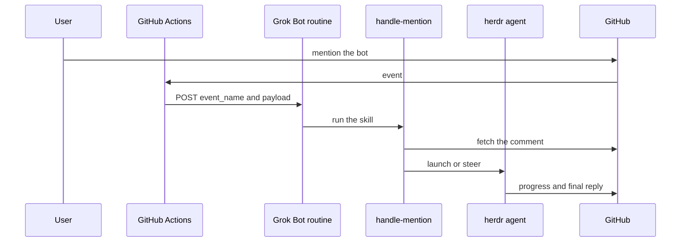

# Architecture

GitHub delivers an event to Actions. The `mention-forward` workflow checks the actor and a coarse mention, then a shell boundary, then POSTs `{event_name, payload}` to the Grok Bot routine. A review request for the bot has no text. The workflow checks the requested reviewer instead, and the router reads the pull request's review-request timeline in place of a comment. The routine runs `handle-mention`. The skill asks `scripts/route-event.mjs` whether to accept, fetches `text_source` from GitHub, records the event under `state_dir/seen/`, and launches or steers one herdr agent. That agent posts progress and the final reply.

`scripts/thread-state.mjs` claims one thread under a lock, writes the request to an immutable file, and records the seen entry only after dispatch succeeds. The thread key is a hash of owner, repo, kind, and number. The seen path hashes the node id and the revision. The work directory includes the owner and the repo.

The installer is `scripts/install.sh`. It renders `templates/mention-forward.yml`, opens a pull request, and merges the repository into the handler config. The routine prompt it prints is `templates/routine-prompt.md`.
