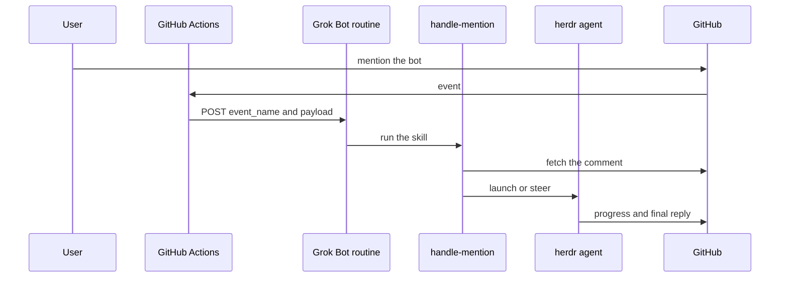

# Architecture

GitHub delivers an event to Actions. The `mention-forward` workflow checks the actor and a coarse mention, then a shell boundary, then POSTs `{event_name, payload}` to the Grok Bot routine. The routine runs `handle-mention`. The skill asks `scripts/route-event.mjs` whether to accept, fetches `text_source` from GitHub, records the event under `state_dir/seen/`, and launches or steers one herdr agent. That agent posts progress and the final reply.

State is one file per thread at `state_dir/jobs/<thread_key>.json`, written by a temp file and `mv`. The seen ledger is one directory per `event_name`, `node_id`, and `updated_at`. Two threads do not share a file.

The installer is `scripts/install.sh`. It renders `templates/mention-forward.yml`, opens a pull request, and merges the repository into the handler config. The routine prompt it prints is `templates/routine-prompt.md`.
